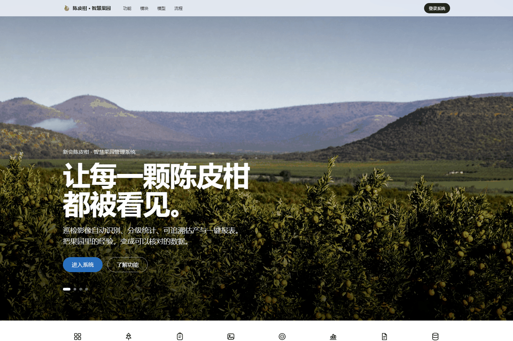
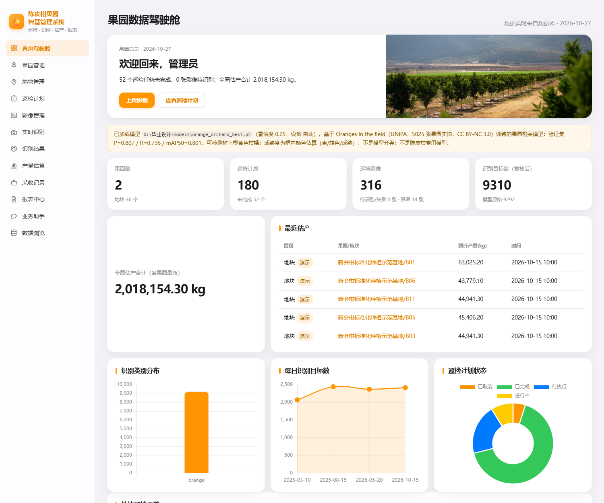
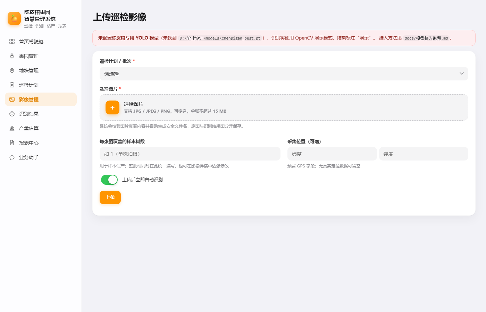
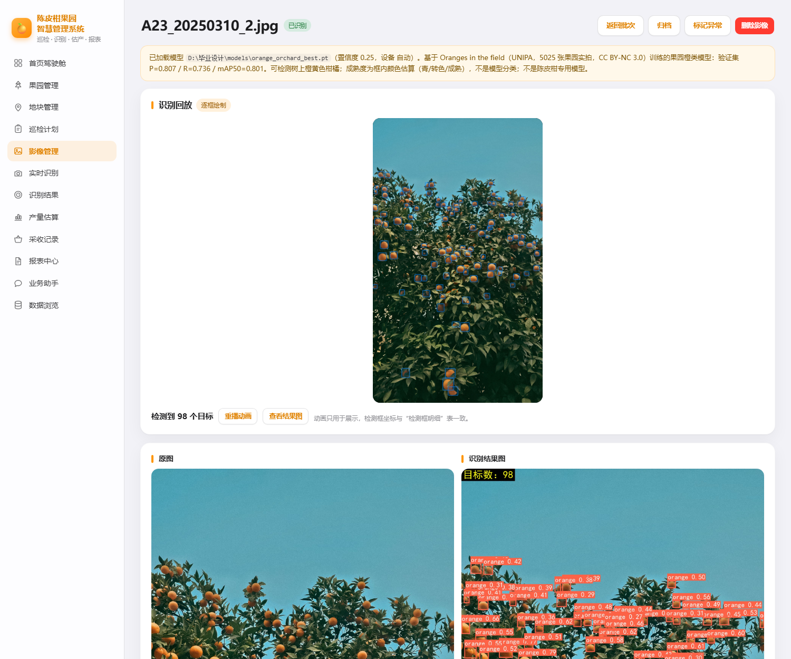
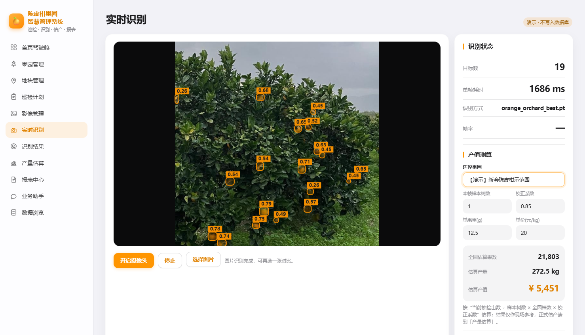
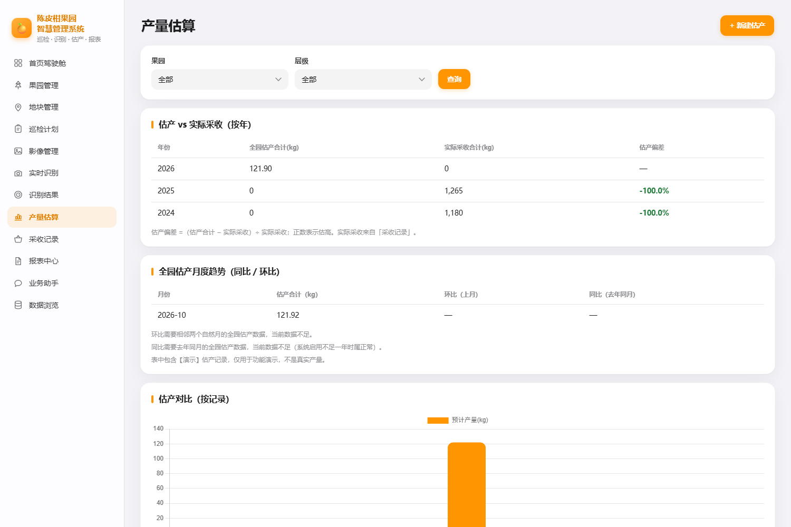
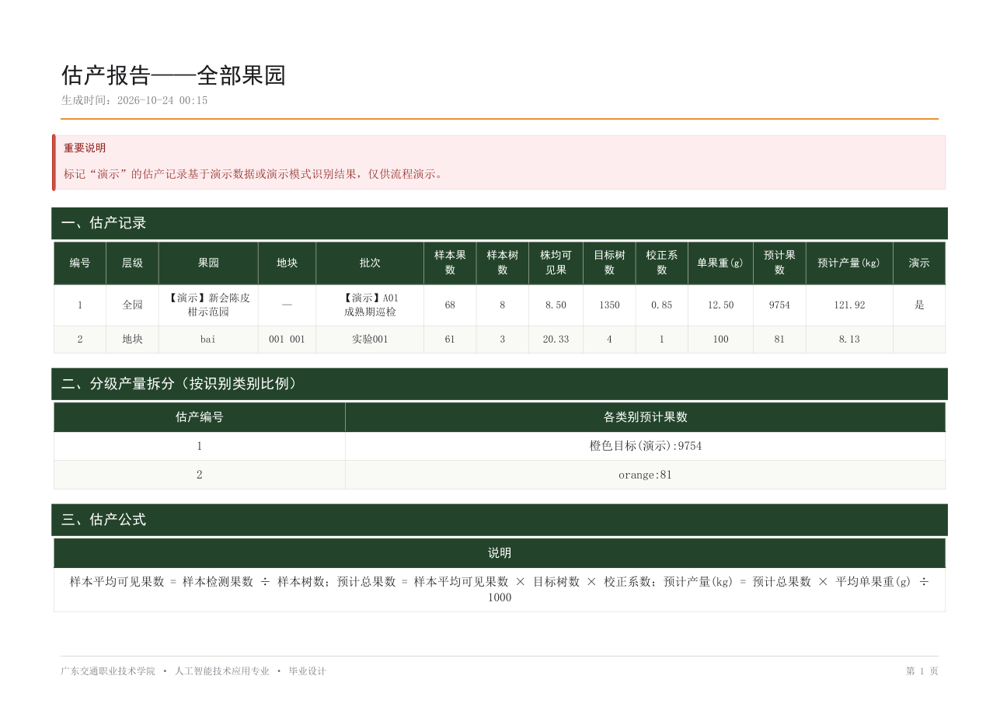
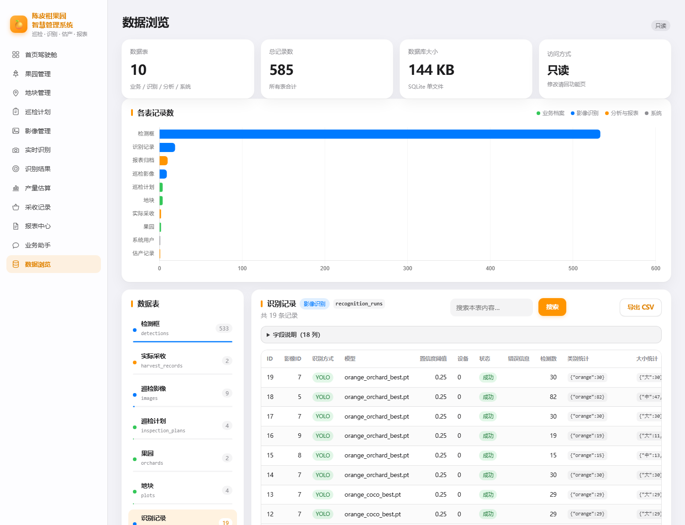

<p align="center">
  
</p>

<h1 align="center">陈皮柑果园智慧管理系统</h1>

<p align="center">
  <b>果园建档 → 巡检计划 → 影像上传 → AI 识别 → 结果复核 → 产量估算 → 图表分析 → Excel / PDF 报表</b>
</p>

<p align="center">
  <sub>Python 3.10 · Flask 3.1 · SQLite · YOLOv8 · pytest 59 条 · Windows 本地运行</sub>
</p>

<p align="center">
  <sub>广东交通职业技术学院 · 信息学院 · 人工智能技术应用专业 · 毕业设计</sub>
</p>

> **一句话**：把果园巡检从「拍照 + Excel + 微信群」搬到浏览器里——每张照片的检测结果可回看、可复核，地块和全园的产量估算带公式与参数留痕，报表可直接导出归档。

---

## 项目简介

陈皮柑（新会柑）果园的日常巡检、病虫害排查、产量预估，长期依赖纸质记录、零散的表格和手机相册。本系统把这些环节串成一条可追溯的业务链：

1. **建档**：果园、地块的编号 / 面积 / 品种 / 株数 / 种植时间入库；
2. **巡检**：创建巡检计划，指定果园、地块、时间、负责人与巡检方式；
3. **采集**：上传巡检影像（单张或多张，JPG / PNG），自动归档到计划；
4. **识别**：YOLOv8 推理果实目标，保存检测框、置信度、结果图，可人工复核；
5. **统计**：按果园 / 地块 / 批次 / 时间筛选汇总，图表来自数据库；
6. **估产**：单株 / 地块 / 全园三级估算，保存公式、参数与数据来源；
7. **报表**：巡检报告、分级统计、估产报告导出 Excel / PDF 并归档。

技术选型刻意保持简单：**单机 Flask + SQLite，不依赖云服务**，答辩现场断网也能完整演示；外部大模型只作为可选能力，不接入也不影响核心业务。

| 项目 | 说明 |
|---|---|
| 运行环境 | Windows 10/11，Python 3.10，可选 NVIDIA GPU（CUDA） |
| 数据存储 | SQLite（WAL 模式），重启后数据仍在 |
| 访问方式 | 浏览器 `http://127.0.0.1:5000` |
| 演示数据 | 全部带「演示」标记，不是真实果园数据 |

---

## 界面预览

上图是对外首页：未登录即可访问，含果园实拍轮播、功能入口与模型指标。登录后的主要页面如下：

<table>
<tr>
<td width="50%"><br><sub><b>数据驾驶舱</b>：果园 / 地块 / 计划 / 影像 / 识别量 / 估产量汇总</sub></td>
<td width="50%"><br><sub><b>影像上传</b>：多文件、类型与内容校验、上传后自动识别</sub></td>
</tr>
<tr>
<td><br><sub><b>识别详情</b>：原图 / 结果图对照、检测框明细与回放</sub></td>
<td><br><sub><b>实时识别</b>：摄像头或本地图片连续送帧，现场估算全园产量</sub></td>
</tr>
<tr>
<td><br><sub><b>产量估算</b>：样本树数、校正系数、单果重与公式留痕</sub></td>
<td><br><sub><b>智能助手</b>：先查数据库事实，再由大模型组织语言</sub></td>
</tr>
<tr>
<td><br><sub><b>报表导出</b>：Excel / PDF，PDF 中文正常显示</sub></td>
<td><br><sub><b>数据浏览</b>：只读查看各表结构与记录，可导出 CSV</sub></td>
</tr>
</table>

> 更多截图（登录页、果园、地块、巡检计划、采收、报表）见 [`docs/images/`](docs/images/)。

---

## 功能特性

### 基础业务

- **数据驾驶舱**：果园 / 地块 / 计划 / 影像 / 识别量 / 估产量汇总与图表，空库时显示空状态，不伪造数字。
- **果园管理**：增删改查，记录名称、编号、地址、面积、品种、种植时间、种植密度、预计株数、备注。
- **地块管理**：与果园真实外键关联，管理地块编号、面积、株数、品种。
- **巡检计划与批次**：计划名称、果园 / 地块、时间、负责人、巡检方式、状态；进度按已识别影像实时计算，不手工填写。
- **影像管理**：JPG / JPEG / PNG 多文件上传，类型与文件头双重校验、大小限制、UUID 文件名防路径穿越；原图与结果图分开存放；支持预览、筛选、归档、异常标记、重新识别。

### AI 识别

- **独立识别服务**：模型加载与缓存、推理、结果解析、结果图绘制分模块封装，配置化置信度 / IoU / 设备，不在每个请求里重复加载模型。
- **检测结果入库**：检测框坐标、类别、置信度、图片关联、识别状态、结果图路径全部持久化。
- **人工复核**：模型原始结果与人工修正结果分开保存，页面可对比。
- **识别回放**：影像详情页按检测框逐帧绘制 + 扫描动画，可重播。
- **实时识别**：摄像头或本地图片连续送帧，画布上实时框选并显示数量 / 耗时；选好果园后可现场估算全园果数、产量与产值（不写库）。
- **模型缺失兜底**：没有权重时退回 OpenCV 演示模式，页面、估产、报表全程标注「演示」，不冒充真实识别。

### 分析与估产

- **结果查询与汇总**：按果园、地块、批次、时间、类别筛选，可下钻到单图详情。
- **三级估产**：单株 / 地块 / 全园，保存数据来源、统计范围、输入参数、计算公式、估算数量与时间。
- **可解释公式**：`样本平均可见果数 = 样本检测果数 ÷ 样本树数`，`预计总果数 = 平均可见果数 × 目标树数 × 校正系数`，`预计产量(kg) = 总果数 × 单果重(g) ÷ 1000`；参数缺失时明确提示，不做无依据外推。
- **同比 / 环比**：仅在历史数据足够且周期明确时计算，否则显示「数据不足」。
- **采收登记**：记录实际采收量，与估产做年度偏差对比。

### 报表、助手与数据浏览

- **三类报表**：巡检报告、果实分级统计、估产报告，导出 Excel（OpenPyXL）与 PDF（ReportLab，中文字体），数值与数据库一致，导出记录归档可再次下载。
- **智能助手**：先由后端查询数据库得出事实，再交给本机 Ollama（默认 qwen3:8b）或任意 OpenAI 兼容接口组织语言；回答可展开「数据库依据」核对；模型不可用时自动退回规则问答。
- **数据浏览**：登录后只读查看各表结构、记录、行数，支持搜索、翻页与 CSV 导出，方便答辩时现场查库。

### 界面与安全

- iOS 风格界面（浅灰底、白色圆角卡片、毛玻璃侧栏），桌面与手机（≤ 820px）自适应；首页为未登录可访问的落地页。
- 登录采用 PBKDF2 密码哈希、8 小时会话、连续失败锁定、首次登录强制改密、开放重定向防护。

---

## 技术栈

| 层次 | 选型 |
|---|---|
| 后端 | Python 3.10 · Flask 3.1 · Flask-SQLAlchemy · SQLite（WAL） |
| 前端 | Jinja2 模板 · 原生 CSS / JavaScript · Chart.js（本地文件，不依赖 CDN） |
| 视觉识别 | Ultralytics YOLOv8 · OpenCV · Pillow · NumPy |
| 报表导出 | OpenPyXL（Excel）· ReportLab（PDF，内置中文字体处理） |
| 智能助手 | Ollama 本地模型 / OpenAI 兼容接口（可选，无密钥不影响主流程） |
| 测试 | pytest（59 条）· requests（端到端 HTTP 自检） |

---

## 快速开始

### 1. 环境要求

- Windows 10 / 11，Python 3.10（已在 3.10.20 验证）
- 可选：NVIDIA 显卡 + CUDA（GPU 推理更快，CPU 也能跑）

### 2. 安装依赖

```bash
python -m venv .venv
.venv\Scripts\activate

# 可选：GPU 版 PyTorch（CUDA 12.1），纯 CPU 可跳过
pip install torch torchvision --index-url https://download.pytorch.org/whl/cu121

pip install -r requirements.txt
```

### 3. 配置

```bash
copy .env.example .env
```

`.env` 中按需修改 `SECRET_KEY`、`ADMIN_PASSWORD`、`MODEL_PATH` 等；**`.env` 已被 `.gitignore` 忽略，不要提交到仓库**。

### 4. 启动

```bash
python run.py
```

浏览器打开 <http://127.0.0.1:5000>。首次启动会自动创建数据库 `instance/orchard.db`、目录 `storage/` 与初始管理员账号。

Windows 下也可以直接双击根目录的 **`启动系统.bat`**。

### 5. 首次登录

| 用户名 | 密码 | 说明 |
|---|---|---|
| `admin` | `admin123` | 首次登录会被强制修改密码；可用 `.env` 的 `ADMIN_PASSWORD` 覆盖 |

忘记密码：`python scripts/reset_admin.py`。

### 6. 生成演示数据（可选）

```bash
python scripts/seed_industry.py
```

先把旧库备份到 `instance/backups/`，再生成 2 个果园、36 个地块、180 个巡检计划、300 多张影像的演示数据；检测框由当前模型对真实柑橘照片实际推理产生，所有记录带「演示」标记。

---

## 目录结构

```text
app/                  Flask 应用
  routes/             13 个蓝图：auth · main · orchards · plots · plans · images
                      live · results · yields · harvest · reports · assistant · database
  services/           storage 存储 · detector 推理 · recognition 入库 · stats 统计
                      yield_service 估产 · reports 报表 · security 登录 · llm 大模型
  templates/          30 个页面（含落地页、实时识别、数据浏览）
  static/             CSS / JS / 果园实拍图
scripts/              演示数据、端到端自检、重置密码、数据集构建、训练脚本
tests/                pytest 测试（59 条）
docs/                 需求 · 设计 · 测试 · 模型 · 助手 · 使用手册 · 答辩 · 截图
datasets/             数据集说明与 data.yaml（图片与标签不入库）
models/               模型目录与说明（权重不入库）
samples/              果园实拍样片
instance/             SQLite 数据库（运行时生成，不入库）
storage/              上传原图、结果图、导出报表（运行时生成，不入库）
run.py                应用入口
启动系统.bat          双击启动
打开数据库.bat        用 DB Browser 查看数据库
```

---

## 模型说明

当前线上模型为 **YOLOv8n**，在公开数据集 *Oranges in the field*（UNIPA，DOI `10.17632/93f32zgkxz.1`，CC BY-NC 3.0）上训练，单类别 `orange`。

| 指标 | 数值 |
|---|---|
| 训练 / 验证 | 2000 张 / 400 张（按果树分组划分，避免同树泄漏） |
| 轮次 | 30 epoch，从 `yolov8n.pt` 微调 |
| Precision | 0.807 |
| Recall | 0.736 |
| mAP@50 | 0.801 |
| mAP@50-95 | 0.449 |

指标来自 `runs/orange_orchard/metrics.json`，未做任何拔高。

**边界必须说清楚**：

- 这是**通用橙类果园模型，不是陈皮柑专用模型**，页面顶部与报表都会注明；
- 「成熟度」由检测框内颜色估算，**不是模型分类输出**；「大小等级」是相对像素占比，不等于真实直径；
- 仓库**不含权重文件**（`.gitignore` 忽略 `*.pt`）。需要真实识别时，把权重放到 `MODEL_PATH` 指向的位置（默认 `models/chenpigan_best.pt`），或用下面的脚本自行训练；
- 没有权重时自动进入 OpenCV 演示模式，结果标注「演示」，绝不冒充实测。

重新训练：

```bash
python scripts/download_unipa.py        # 下载公开数据集（约 775 MB）
python scripts/build_unipa_dataset.py   # 转 YOLO 目录结构
python scripts/train_yolo.py --data datasets/orange_orchard/data.yaml
```

训练与接入细节见 [docs/模型接入说明.md](docs/模型接入说明.md)。

### 智能助手（可选）

- 默认接本机 Ollama：`LLM_PROVIDER=ollama`、`LLM_BASE_URL=http://127.0.0.1:11434`、`LLM_MODEL=qwen3:8b`；
- 也可切换任意 OpenAI 兼容接口（DeepSeek、通义、Moonshot 等）：`LLM_PROVIDER=openai` + `LLM_BASE_URL` + `LLM_API_KEY`；
- 回答 = **数据库事实（后端查询）+ 模型组织语言**，页面可展开「数据库依据」核对；模型异常时自动退回规则问答；
- 密钥只从环境变量读取，不写入代码、不进入仓库。

---

## 测试与验证

```bash
python -m pytest -q              # 59 条自动化测试
python scripts/db_view.py        # 只读查看数据库表与行数
python scripts/smoke_e2e.py      # 对运行中的服务做端到端 HTTP 自检
```

端到端脚本默认访问 `http://127.0.0.1:5000`，可用 `BASE_URL` / `SMOKE_USER` / `SMOKE_PASS` 指定目标；覆盖登录、13 个页面与接口、建档、上传并自动识别、人工复核、估产、导出 XLSX / PDF、图表与助手。

已实际验证的结论：

- `pytest` 59 条全部通过；端到端自检全部通过；
- 重启服务后数据仍在（SQLite 持久化）；
- 报表导出数值与数据库一致，PDF 中文正常；
- 模型推理链路用真实权重跑通（模型缓存、检测框入库、结果图生成）。

---

## 文档导航

| 文档 | 内容 |
|---|---|
| [docs/项目完全解析.md](docs/项目完全解析.md) | 从 HTTP、数据库原理讲起，逐模块讲解代码与答辩口径 |
| [docs/使用手册.md](docs/使用手册.md) | 各页面怎么操作、数据存在哪、常见问题 |
| [docs/需求分析.md](docs/需求分析.md) | 业务需求、角色、用例与边界 |
| [docs/系统设计.md](docs/系统设计.md) | 架构、模块划分、数据库设计、关键流程 |
| [docs/测试说明.md](docs/测试说明.md) | 测试用例、执行结果与验证记录 |
| [docs/模型接入说明.md](docs/模型接入说明.md) | 数据集、训练、验证、权重切换与接入步骤 |
| [docs/论文-模型章节.md](docs/论文-模型章节.md) | 可直接改写进论文的模型章节素材 |
| [docs/答辩演示流程.md](docs/答辩演示流程.md) | 演示脚本与讲解要点 |
| [docs/智能助手说明.md](docs/智能助手说明.md) | 助手架构、提示词与降级策略 |
| [docs/Git与GitHub使用.md](docs/Git与GitHub使用.md) | 日常提交、代理与常见报错处理 |

---

## 常见问题

- **页面提示「已加载模型 … 不是陈皮柑专用模型」**：这是正常提示。换成专用权重只需把 `best.pt` 放到 `MODEL_PATH` 指向的位置并修改 `MODEL_NOTE`，无需重启（按文件修改时间自动重载）。
- **识别结果是「演示」而不是检测框**：说明当前没有可用权重，属于预期的降级行为；放入权重后自动切换为真实推理。设置 `ALLOW_DEMO_DETECTOR=0` 可关闭演示模式。
- **数据库在哪？** `instance/orchard.db`；双击根目录「打开数据库.bat」可用内置 DB Browser 查看。
- **端口被占用**：设置环境变量 `PORT=5001` 后重新启动。
- **估产提示「样本树数必须大于 0」**：在上传页或影像详情页填写「每张图覆盖的样本树数」。
- **PDF 中文乱码**：需要 Windows 自带字体 `C:\Windows\Fonts\simhei.ttf` 或 `simsun.ttc`。
- **登录被锁**：连续输错 5 次会锁定当前会话，关闭浏览器重试，或执行 `python scripts/reset_admin.py`。
- **换成自己的照片识别效果差**：先确认权重类型（通用橙类 vs 专用），再考虑补充本地标注数据重新训练。

---

## 已知限制

- **没有陈皮柑专用数据集与权重**：现有模型训练自公开橙类果园数据，对陈皮柑（新会柑）的泛化能力有限，不能宣称「可靠的陈皮柑检测」。
- **成熟度与大小等级是启发式估算**：前者基于框内颜色，后者是像素相对占比，均非模型分类结果。
- **未接入真实采收历史**：同比 / 环比需要用户自行登记采收数据，数据不足时系统如实提示。
- **无人机能力仅预留**：以网页上传航拍图或普通果园照片为入口，没有飞控、GPS 与正射影像处理，不宣称自动巡航。
- **演示数据结构化生成**：`seed_industry.py` 产出的是演示数据，全部带标记，不能当作真实生产数据引用。

---

## 许可与致谢

- 本项目为毕业设计作品，仅供学习、教学与答辩演示使用。
- 果园实拍素材来自 [Pexels](https://www.pexels.com/)（免费许可），来源与许可见 `素材/来源.txt`、`samples/果园实拍样例/来源与许可.txt`。
- 训练数据：*Oranges in the field*（UNIPA），DOI [10.17632/93f32zgkxz.1](https://doi.org/10.17632/93f32zgkxz.1)，**CC BY-NC 3.0（非商业）**。
- 基础权重：Ultralytics YOLOv8（AGPL-3.0）。
